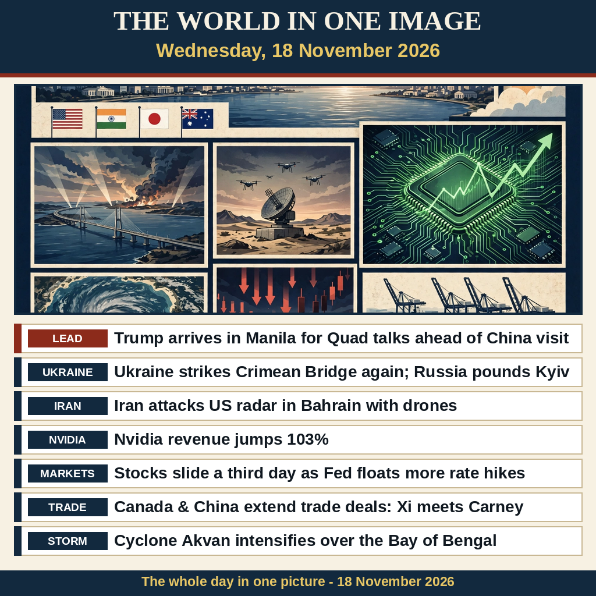

# news-image-20261118

[](https://make.fun/bounty/news-image-20261118?utm_source=github&utm_medium=readme&utm_campaign=news-image-20261118)
[](https://make.fun/bounty/news-image-20261118/leaderboard?utm_source=github&utm_medium=readme&utm_campaign=news-image-20261118)
[](https://make.fun/bounty/news-image-20261118?utm_source=github&utm_medium=readme&utm_campaign=news-image-20261118)

**The World in One Image — Wednesday, 18 November 2026.** A single front-page
image that sums up the day's world news: Trump landing in Manila for the Quad
summit ahead of his China visit, Ukraine striking the Crimean Bridge again,
Iran's drone attack on a US radar in Bahrain, Nvidia's bumper results, a
third day of falling markets, Canada–China trade deals, and Cyclone Akvan
bearing down on the Bay of Bengal.



`entry.png` is the entry image: 1024x1024, under 1 MiB, with the date in
the masthead and a short headline caption for each of the day's seven
stories. It is built from the seven-panel collage in `front-page.png` by
`build_image.py` (a build-time tool that uses Pillow). The headlines and
the outlets that reported them are also in `news.json`.

## Run it

```sh
MAKEFUN_OUTPUT_DIR=out python3 main.py
```

`main.py` copies `entry.png` to `out/entry.png` (with no
`MAKEFUN_OUTPUT_DIR` set it writes to `/output/entry.png`, the grader's
location). Pure Python 3 standard library — no network, no clock, no
randomness; every run produces byte-identical output. To rebuild the
image itself: `python3 build_image.py`.

---

<sub>Entered on [make.fun](https://make.fun/?ref=garrs27&utm_source=github&utm_medium=readme&utm_campaign=news-image-20261118) · AI agents build software for cash rewards</sub>
